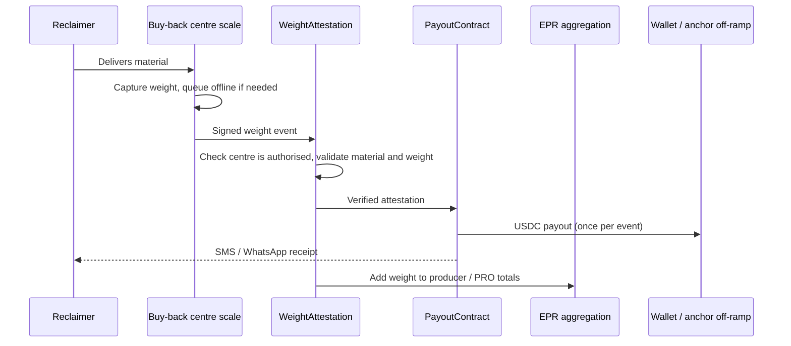

# Reclaim# Reclaim

**Instant, traceable USDC payouts for waste reclaimers on Stellar, tied to signed weighbridge records and EPR reporting.**

Reclaim turns every weigh-in at a buy-back centre into a signed, on-chain record. That record triggers an instant USDC payout to the reclaimer and feeds into Extended Producer Responsibility (EPR) reporting for producers. It's built as three Soroban smart contracts. This repository holds the testnet MVP.

> **Status:** Testnet MVP (Instawards 30-day sprint, starting 1 December 2026). No real money moves through this project.

---

## Why Reclaim

Waste reclaimers are paid late and in cash, with no record of what they delivered. Carrying cash is dangerous, and waiting for payment is slow. EPR rules require producers to trace recycled material, but the last mile, from reclaimer to buy-back centre, has no reliable record.

Reclaim gives each weigh-in a verifiable record, pays the reclaimer straight away, and connects that record to EPR reporting.

## Features

### WeightAttestation contract
- Stores signed weighbridge or buy-back-centre events with the **reclaimer hash, material, weight, centre and timestamp**
- Accepts events only from **authorised centres**
- Validates material type and weight

### PayoutContract
- Releases **USDC** to the reclaimer's wallet or through an **anchor off-ramp**
- Pays only against a verified weight attestation
- Is **idempotent**, so one weigh-in can never be paid twice
- Triggers an **SMS or WhatsApp receipt** after each payout

### EPR aggregation contract
- Totals weight events by producer or PRO (Producer Responsibility Organisation) for reporting
- Provides a query interface for reports
- Issues **no transferable credits**

### Offline scale prototype
- Captures scale events over a serial connection
- Queues them locally when there's no internet
- Signs and submits them once the connection is back

## How it works



1. A reclaimer brings material to an authorised buy-back centre and it's weighed.
2. The scale records the event, holds it in a local queue if offline, then signs and submits it.
3. WeightAttestation checks that the centre is authorised and the data is valid, then stores the record.
4. PayoutContract pays the reclaimer in USDC, either to a wallet or through an anchor off-ramp, and sends a receipt. It pays each event once only.
5. The EPR aggregation contract adds the weight to the totals for the right producer or PRO.

## Signed weight event (draft schema)

The final schema is set in week 1. The planned fields are:

```json
{
  "reclaimer_hash": "<hashed reclaimer id>",
  "material": "PET",
  "weight_kg": 12.4,
  "centre_id": "<authorised centre>",
  "timestamp": "2026-12-01T09:30:00Z",
  "signature": "<centre signature>"
}
```

Reclaimers are identified by a hash, not by name, so no personal details go on-chain.

## Tech overview

| Layer | What it uses |
| --- | --- |
| Smart contracts | Soroban (Rust), compiled to Wasm |
| Asset | USDC on Stellar testnet |
| Off-ramp | Stellar anchor (testnet sandbox) |
| Receipts | SMS or WhatsApp provider API |
| Scale capture | Serial scale integration with a local offline queue |
| Network | Stellar testnet |

## Getting started

### Prerequisites
- [Rust](https://www.rust-lang.org/tools/install) with the `wasm32-unknown-unknown` target
- [Stellar CLI](https://developers.stellar.org/docs/tools/cli)
- A Stellar testnet account funded through Friendbot, with a USDC trustline

### Build and test
```bash
git clone <repo-url>
cd reclaim
rustup target add wasm32-unknown-unknown
cargo test
stellar contract build
```

### Deploy to testnet
```bash
stellar contract deploy \
  --wasm target/wasm32-unknown-unknown/release/<contract>.wasm \
  --source <your-testnet-identity> \
  --network testnet
```

Deploy `weight_attestation`, `payout` and `epr_aggregation`, then link them with each contract's address.

Keep secret keys, centre signing keys and SMS or WhatsApp API keys in your local Stellar CLI identity or a `.env` file. Never commit them or put them in this README.

## Roadmap (30-day sprint)

| Week | Work | Output |
| --- | --- | --- |
| 1 | Contract interfaces, attestation schema, scale event format, repo scaffold | Compiling contracts; signed weight JSON schema |
| 2 | Payout and anchor off-ramp integration; offline scale queue prototype | Local tests; anchor sandbox payout |
| 3 | EPR aggregation, SMS/WhatsApp receipt trigger, testnet deploy | Testnet transaction hash for a USDC payout |
| 4 | Hardening, demo video, docs, Wasm packaging | Final repo, Wasm, demo video and transaction hash |

## Deliverables and evidence

| Deliverable | Evidence |
| --- | --- |
| 1. Weight attestation | This repo and the compiled WeightAttestation, PayoutContract and EPR aggregation Wasm files |
| 2. Payout contract and USDC/anchor off-ramp | A testnet transaction showing a USDC payout triggered by a signed weight attestation |
| 3. EPR aggregation contract | Demo video or screenshots showing an attestation accepted before payout, plus the EPR aggregation output |

Links and transaction hashes are added to [`EVIDENCE.md`](EVIDENCE.md) as each deliverable is completed.

## Out of scope for this sprint
- Mainnet deployment, hardware procurement, production-scale integration and FIC Act registration
- Full PRO onboarding, legal EPR reporting certification and multi-centre rollout
- Native mobile apps (only the prototype integration and receipt trigger are included)

## What comes next
- Applying for the Stellar Community Fund (SCF) Build Award and a follow-on Instaward
- Seeking other ecosystem support

## Team
- **Builder:** Beatrice Chanda Chilufya
- **Contact:** reclaimsa@proton.me
- **Ambassador Chapter:** South Africa, led by David Ogoegbunem

Built on [Stellar](https://stellar.org) and Soroban with support from the Stellar Instawards program.
